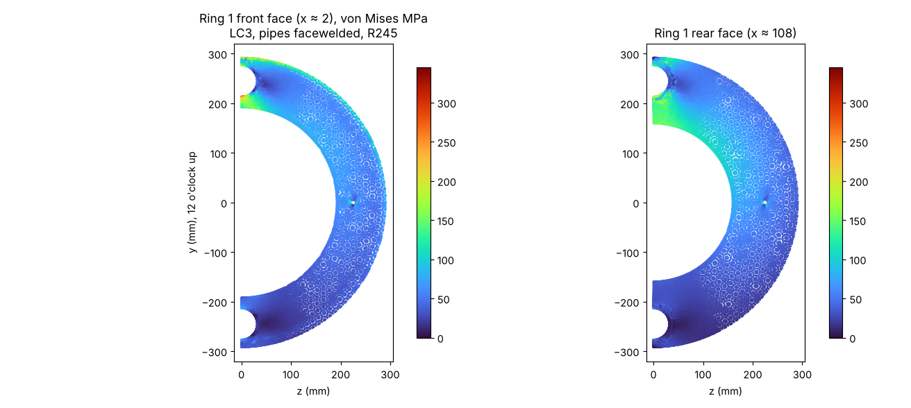
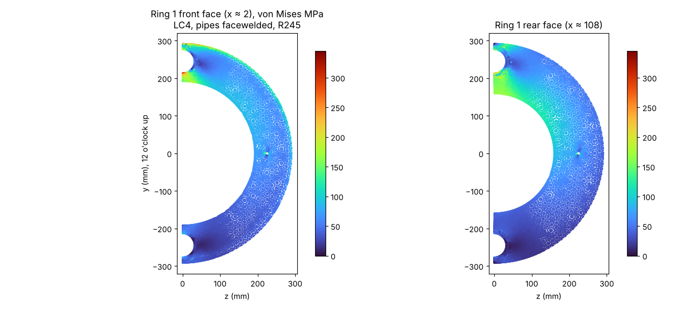

# Design manual Rev I · 02 Shell weldment

UATXcavators DN600 slurry microTBM (micro tunnel boring machine). Revision I, 2026-10-28. Generated by `tools/make_manual.py` from the model and calculation scripts in the repo; edit those, not this file.

Units mm, N, MPa (kN, kNm in tables). x = 0 at the ring 1 front face, +x rearward. Clock positions are seen from the front, looking rearward: 0° = 12 o'clock, 90° = 3 o'clock.

The shell weldment is the stationary structure: the shield shell, the bulkhead (ring 1) welded inside it, the slurry pipes through the bulkhead, and the parts welded to the shell. It is built once and does not come apart. Calculations: `src/calc_revI.py` (rows SH, R1, PI, FN), `src/fea_ring1.py`.

Parts and masses (model):

| Key | Part | kg |
|---|---|---|
| shell | Shield shell Ø609.6 × 12.7 × 1285, rear Ø590.6 × 12 counterbore | 238.55 |
| ring1 | Ring 1, 110 thk A572 Gr 42, Ø384 × 30 counterbore | 144.70 |
| weld | Ring 1 weld, 14 mm fillet from the front | 1.39 |
| pipes | Slurry pipes Ø76.2 × 6.35, 12 + 6, x = 0 to 1,255 | 27.46 |
| pipewelds | Pipe welds: 6 × 45° front seal weld + 6 mm rear fillet | 0.15 |
| saddles | Pipe saddles | 0.26 |
| taps | Pressure-tap tubes, flush | 0.12 |
| fin30 | Anti-roll fin 20 × 70 × 990 at 30° | 9.81 |
| fin90 | Anti-roll fin 20 × 70 × 990 at 90° | 9.81 |
| fin270 | Anti-roll fin 20 × 70 × 990 at 270° | 9.81 |
| fin330 | Anti-roll fin 20 × 70 × 990 at 330° | 9.81 |
| finwelds | Fin welds, 2 × 8 mm fillets | 1.94 |
| liftboss | Lifting bosses ×4, Ø60 × 40, M20 (hoist rings) | 3.31 |
| liftplug | Lifting-boss plugs ×4, M20 set screws | 0.14 |

## 2.1 Shield shell

| Item | Value |
|---|---|
| Function | Outer skin of the machine. Carries the full thrust from ring 1 to its rear end, the torque reaction from ring 1 to the fins and the ground, and ground pressure |
| Size | Ø609.6 × 12.7 wall (24 in, 0.500 in wall pipe), 1,285 long, x = -128 to 1157; rear end counterbored Ø590.6 × 12 for the thrust ring register (end wall 9.5) |
| Material | API 5L Gr B / ASTM A53 Gr B assumed (Fy 241); grade to confirm with the stock pipe |
| Manufacture | Saw; face both ends on the lathe to 1,285.0. The front end face is the datum for the ring 1 depth |
| Section | A = π/4 (609.6² − 584.2²) = 23,815 mm²; S = π (609.6⁴ − 584.2⁴) / (32 × 609.6) = 3,481,368 mm³ |
| Mass | 238.6 kg |

The shell is a short, thick tube (D/t = 48, length 2.1 D): it cannot buckle as a column and is compact for local buckling. Stress is set by direct compression plus the jam moment, and by the local load path at ring 1 (FEA, section 2.2).

| ID | Part | Check | Case | Value | Allowable (basis) | FoS | FoS yield | Required | Status |
|---|---|---|---|---|---|---|---|---|---|
| SH-1 | Shield shell | axial compression + bending behind ring 1 | LC3 | 58.8 MPa | 144.6 (0.6 Fy) | 2.46 | 4.10 | 1.00 | ok |
| SH-1 | Shield shell | axial compression + bending behind ring 1 | LC4 | 66.0 MPa | 144.6 (0.6 Fy) | 2.19 | 3.65 | 1.00 | ok |
| SH-2 | Shield shell | local buckling, D/t vs AISC compact limit 0.11 E/Fy | geometry | 48.0 – | 91.3 (compact limit) | 1.90 | – | 1.00 | ok |
| SH-3 | Shield shell | external pressure: long-tube buckling vs 0.10 MPa ground + slurry pressure | geometry | 0.10 MPa | 4.0 (p_cr) | 39.75 | – | 1.00 | ok |
| SH-4 | Shield shell | torsion at 20 kNm | torque | 2.81 MPa | 96.4 (0.4 Fy) | 34.26 | 49.42 | 1.00 | ok |
| SH-5 | Shield shell | rear end bearing on the thrust ring / casing face | LC3 | 33.6 MPa | 216.9 (0.9 Fy) | 6.45 | 7.17 | 1.00 | ok |
| SH-5 | Shield shell | rear end bearing on the thrust ring / casing face | LC4 | 37.8 MPa | 216.9 (0.9 Fy) | 5.73 | 6.37 | 1.00 | ok |
| SH-6 | Shield shell | FEA: shell behind the ring (x > 120), peak | LC2 | 54.4 MPa | 241.0 (Fy) | 4.43 | 4.43 | 1.50 | ok |
| SH-6 | Shield shell | FEA: shell behind the ring (x > 120), peak | LC3 | 70.3 MPa | 241.0 (Fy) | 3.43 | 3.43 | 1.50 | ok |
| SH-6 | Shield shell | FEA: shell behind the ring (x > 120), peak | LC4 | 78.8 MPa | 241.0 (Fy) | 3.06 | 3.06 | 1.00 | ok |

Equations behind the rows:

- **SH-1 LC3**: σ = F/A + M/S = 800.6 kN / 23,815 mm² + 87.54 kNm / 3,481e3 mm³ → **58.76 MPa**
- **SH-1 LC4**: σ = F/A + M/S = 901.4 kN / 23,815 mm² + 98.07 kNm / 3,481e3 mm³ → **66.02 MPa**
- **SH-2 geometry**: D/t = 609.6/12.7 = 48.0;  0.11 E/Fy = 0.11 × 200,000/241 = 91.3 → **48.00 –**
- **SH-3 geometry**: p_cr = 2E/(1−ν²)·(t/D)³ = 2 × 200,000/0.91 × (12.7/609.6)³ = 3.97 MPa → **0.10 MPa**
- **SH-4 torque**: τ = T/(2π r² t) = 20e6/(2π × 298.4² × 12.7) → **2.81 MPa**
- **SH-5 LC3**: σ = F/A = 800.6 kN / 23,815 mm² → **33.62 MPa**
- **SH-5 LC4**: σ = F/A = 901.4 kN / 23,815 mm² → **37.85 MPa**
- **SH-6 LC2**: max von Mises in the shell → **54.36 MPa**
- **SH-6 LC3**: max von Mises in the shell → **70.26 MPa**
- **SH-6 LC4**: max von Mises in the shell → **78.81 MPa**


## 2.2 Ring 1 (bulkhead)

| Item | Value |
|---|---|
| Function | Bulkhead between the slurry chamber and the dry interior. Carries the whole thrust and jam moment from the split flange to the shell; reacts the drive torque |
| Thickness / OD / bore | 110 / Ø583.2 (shell ID − 1.0: 0.5 radial gap, so the front fillet weld is the only connection) / Ø318.5 |
| Counterbore | Ø384 × 30 deep at the front face, 3 × 45° chamfer on the edge, 2 mm radius on the floor corner. The split flange sits in it flush with the plate face; its floor (x = 30) is the seat |
| Web under the seat | 110 − 30 = 80 thick |
| Holes | 16 × M12 on Ø354, 26 deep from the seat (phase 11.25°); 2 × Ø16 H7 dowel holes on Ø354 at 12 and 6; 2 × Ø77 pipe holes at R245, 12 and 6, with a 6 × 45° bevel at the front face; 2 × Ø12 pressure-tap holes at R225, 3 and 9 |
| Material | A572 Gr 42, 4.5 in plate (Fy 290, Fu 415) |
| Mass | 144.7 kg |
| Manufacture | Waterjet blank (OD + 2) → Blanchard grind both faces to 110.0, flat 0.05 → lathe: OD = measured shell ID − 1.0, Ø318.5 bore, Ø384 × 30 counterbore → drill and tap 16 × M12 → slurry pipes welded in on the bench (2.4) → into the shell on the gauge legs, 14 mm fillet from the front |

### Why the counterbore and pipe holes are where they are

The split flange (chapter 03) must sit flush with the plate face, because the only part allowed ahead of ring 1 is the rotating cutterhead (8 mm from the plate). The flange therefore lives in a counterbore, and the counterbore radius is set by the flange: bolt circle = counterbore − 30, so the M12 heads (Ø18 in Ø20 counterbores) clear the flange OD by 5. The slurry pipes sit at R245 (12 and 6 o'clock) so they clear the cartridge, drive and motor in the middle. The wall between the counterbore and a pipe hole is

```
w = (R_pipe − d_hole/2) − R_cb = (245 − 38.5) − 192 = 14.5 mm          (Rev H: 206.5 − 200 = 6.5 mm)
```

The jam moment is carried by an uneven seat pressure, highest on the side of the off-centre thrust. Any clock position can carry the jam, so the analysis puts it at 12 o'clock, over a pipe hole. There the narrow wall between the counterbore and the pipe hole carries the ring's hoop compression around the hole, and it governs the ring.

### Design study (FEA, LC3)

The ring 1 FEA model (`src/fea_ring1.py`) is ring 1, its front fillet weld and the shell to x = 500, half model. Each row changes one thing:

| Variant | M at seat (kNm) | Pm, ligament (MPa) | Pm + Pb, ligament (MPa) | Peak (MPa) |
|---|---|---|---|---|
| Rev H: Ø400 × 35, pipes open (front seal weld only) | 87.08 | – | – | 461 |
| Ø392 × 35, pipes open | 87.08 | – | – | 378 |
| Ø400 × 35, Ø76.1 × 5.55 pipe fused over 110 | 87.08 | – | – | 295 |
| Ø392 × 35, Ø76.1 × 5.55 pipe fused | 87.08 | – | – | 272 |
| Ø392 × 35, Ø76.2 × 6.35 pipe fused | 87.08 | 154 | 220 | 263 |
| Ø384 × 35, pipe fused | 87.08 | 147 | 198 | 248 |
| Ø384 × 35, pipe welded at both faces only (as built) | 87.51 | 162 | 196 | 896 |
| **Rev I: Ø384 × 30, pipe welded at both faces** | 87.49 | 157 | 187 | 213 (on the lines) |

Readings:
- Open holes (Rev H) put a 377-461 MPa peak at the hole edge: the hole is a stress raiser in a thin wall.
- Fusing the pipe into the hole over the full 110 (an upper bound on the pipe's help) lowers it to about 260; a thicker pipe wall helps a little.
- The pipe as built is welded only at the two faces, with a 0.4 mm radial gap between (Ø77 hole, Ø76.2 pipe). Modelled that way, Pm + Pb in the wall is close to the fused model: the welds at the faces do most of the work. The peak in that model sits at the root of the 0.4 mm gap behind the front weld, a crack-like corner whose linear-elastic stress has no finite value; it is excluded and the wall is judged on Pm + Pb.
- Shrinking the counterbore from Ø400 to Ø384 widens the wall from 6.5 to 14.5 mm; a 30 deep counterbore instead of 35 thickens the web from 75 to 80. With Fy 290 (A572 Gr 42, I-2) the LC3 requirement is Pm + Pb ≤ 290/1.5 = 193 MPa; Ø384 × 35 gave 196 and Ø384 × 30 gives 187.
- The earlier option runs used M = F·e + M_g (87.08 kNm); the Rev I runs use the vector sum with the side-force moment (87.52 kNm).

### FEA results, Rev I

| Case | F (kN) | M (kNm) | Pm ligament | Pm + Pb ligament | at | Peak on the lines | Web Pm + Pb | Tapped holes peak | Rest of ring peak | Shell peak | Seat axial disp. (mm) | DOF |
|---|---|---|---|---|---|---|---|---|---|---|---|---|
| LC2 | 613.1 | 67.94 | 122 | 145 | x = 10 | 164 | 120 | 203 | 148 | 54 | 0.309 | 791,511 |
| LC3 | 800.6 | 87.49 | 157 | 187 | x = 10 | 213 | 156 | 263 | 191 | 70 | 0.400 | 791,511 |
| LC4 | 901.4 | 98.04 | 177 | 210 | x = 10 | 239 | 175 | 295 | 215 | 79 | 0.448 | 791,511 |

All stresses von Mises, MPa. Linearization lines, LC3 (p0 = counterbore wall or seat, p1 = pipe hole or rear face):

| Line | Length | Pm | Pm + Pb at p0 | Pm + Pb at p1 | Peak on the line |
|---|---|---|---|---|---|
| ligament_x1 | 13.4 | 157 | 133 | 182 | 187 |
| ligament_x4 | 14.4 | 147 | 125 | 169 | 163 |
| ligament_x10 | 14.4 | 145 | 104 | 187 | 213 |
| ligament_x20 | 14.4 | 125 | 90 | 161 | 179 |
| ligament_x30 | 14.4 | 94 | 74 | 117 | 129 |
| web_R164_0deg | 79.9 | 39 | 103 | 156 | 157 |
| web_R164_90deg | 79.9 | 42 | 51 | 85 | 81 |
| web_R245_30deg | 110.0 | 14 | 64 | 64 | 64 |





### Cross-check with the hand model

The Rev H hand model treats ring 1 as an annular plate, 80 thick out to the counterbore and 110 beyond, pinned at the weld, with the seat load and jam moment as a peak line load P + 2M/r at the seat centroid (row R1-7): 147 MPa at LC3. The FEA web lines through the same 80 thickness at R164 give 156 MPa at 12 o'clock (5 mm from the dowel hole, under the peak of the jam pressure) and 85 MPa at 3 o'clock (row R1-4). The plate model matches the most loaded web line within 6 %; it cannot see the pipe-hole wall, which governs.

| ID | Part | Check | Case | Value | Allowable (basis) | FoS | FoS yield | Required | Status |
|---|---|---|---|---|---|---|---|---|---|
| R1-1 | Ring 1 | FEA: 12 o'clock pipe ligament, membrane Pm (linearized) | LC2 | 121.6 MPa | 193.3 (Fy/1.5) | 1.59 | 2.38 | 1.00 | ok |
| R1-2 | Ring 1 | FEA: pipe ligament, membrane + bending Pm+Pb (x = 10) | LC2 | 144.7 MPa | 290.0 (Fy) | 2.00 | 2.00 | 1.50 | ok |
| R1-3 | Ring 1 | FEA: peak on the ligament lines (hole edge behind the weld, local) | LC2 | 164.3 MPa | 290.0 (Fy) | 1.76 | 1.76 | 1.00 | ok |
| R1-4 | Ring 1 | FEA: web behind the counterbore (80 thk), Pm+Pb | LC2 | 120.2 MPa | 290.0 (Fy) | 2.41 | 2.41 | 1.50 | ok |
| R1-5 | Ring 1 | FEA: tapped holes M12 (peak) | LC2 | 202.9 MPa | 290.0 (Fy) | 1.43 | 1.43 | 1.00 | ok |
| R1-6 | Ring 1 | FEA: rest of the ring (peak) | LC2 | 148.0 MPa | 290.0 (Fy) | 1.96 | 1.96 | 1.00 | ok |
| R1-1 | Ring 1 | FEA: 12 o'clock pipe ligament, membrane Pm (linearized) | LC3 | 157.4 MPa | 193.3 (Fy/1.5) | 1.23 | 1.84 | 1.00 | ok |
| R1-2 | Ring 1 | FEA: pipe ligament, membrane + bending Pm+Pb (x = 10) | LC3 | 187.3 MPa | 290.0 (Fy) | 1.55 | 1.55 | 1.50 | ok |
| R1-3 | Ring 1 | FEA: peak on the ligament lines (hole edge behind the weld, local) | LC3 | 212.7 MPa | 290.0 (Fy) | 1.36 | 1.36 | 1.00 | ok |
| R1-4 | Ring 1 | FEA: web behind the counterbore (80 thk), Pm+Pb | LC3 | 155.5 MPa | 290.0 (Fy) | 1.86 | 1.86 | 1.50 | ok |
| R1-5 | Ring 1 | FEA: tapped holes M12 (peak) | LC3 | 262.5 MPa | 290.0 (Fy) | 1.10 | 1.10 | 1.00 | ok |
| R1-6 | Ring 1 | FEA: rest of the ring (peak) | LC3 | 191.5 MPa | 290.0 (Fy) | 1.51 | 1.51 | 1.00 | ok |
| R1-1 | Ring 1 | FEA: 12 o'clock pipe ligament, membrane Pm (linearized) | LC4 | 176.7 MPa | 193.3 (Fy/1.5) | 1.09 | 1.64 | 1.00 | ok |
| R1-2 | Ring 1 | FEA: pipe ligament, membrane + bending Pm+Pb (x = 10) | LC4 | 210.2 MPa | 290.0 (Fy) | 1.38 | 1.38 | 1.00 | ok |
| R1-3 | Ring 1 | FEA: peak on the ligament lines (hole edge behind the weld, local) | LC4 | 238.7 MPa | 290.0 (Fy) | 1.21 | 1.21 | reported | ok |
| R1-4 | Ring 1 | FEA: web behind the counterbore (80 thk), Pm+Pb | LC4 | 174.5 MPa | 290.0 (Fy) | 1.66 | 1.66 | 1.00 | ok |
| R1-5 | Ring 1 | FEA: tapped holes M12 (peak) | LC4 | 294.6 MPa | 290.0 (Fy) | 0.98 | 0.98 | reported | ok |
| R1-6 | Ring 1 | FEA: rest of the ring (peak) | LC4 | 214.9 MPa | 290.0 (Fy) | 1.35 | 1.35 | reported | ok |
| R1-7 | Ring 1 | hand model: stepped annular plate 80 / 110, peak line load (P + 2M/r) at the seat centroid | LC3 | 147.2 MPa | 290.0 (Fy) | 1.97 | 1.97 | 1.50 | ok |
| R1-10 | Ring 1 | M12 tapped holes (24 engaged): thread strip at bolt proof load | assembly | 154.7 MPa | 249.0 (0.6 Fu) | 1.61 | – | 1.00 | ok |

Equations behind the rows:

- **R1-1 LC2**: Pm = mean σ along the counterbore-wall → pipe-hole line, max over depth x = 1-30; von Mises → **121.63 MPa**
- **R1-2 LC2**: Pm + Pb at the ligament surface (linear part of σ along the line) → **144.69 MPa**
- **R1-3 LC2**: max von Mises along the lines → **164.33 MPa**. zone maximum 297 MPa sits at the root of the 0.4 mm pipe-to-hole gap behind the front weld (crack-like corner, singular in a linear model)
- **R1-4 LC2**: linearized through the thickness at R164, 12 and 3 o'clock → **120.17 MPa**
- **R1-5 LC2**: max von Mises within 16 mm of the hole bottoms → **202.89 MPa**. peak stress
- **R1-6 LC2**: max von Mises outside the zones above → **147.98 MPa**
- **R1-1 LC3**: Pm = mean σ along the counterbore-wall → pipe-hole line, max over depth x = 1-30; von Mises → **157.43 MPa**
- **R1-2 LC3**: Pm + Pb at the ligament surface (linear part of σ along the line) → **187.28 MPa**
- **R1-3 LC3**: max von Mises along the lines → **212.70 MPa**. zone maximum 385 MPa sits at the root of the 0.4 mm pipe-to-hole gap behind the front weld (crack-like corner, singular in a linear model)
- **R1-4 LC3**: linearized through the thickness at R164, 12 and 3 o'clock → **155.51 MPa**
- **R1-5 LC3**: max von Mises within 16 mm of the hole bottoms → **262.50 MPa**. peak stress
- **R1-6 LC3**: max von Mises outside the zones above → **191.48 MPa**
- **R1-1 LC4**: Pm = mean σ along the counterbore-wall → pipe-hole line, max over depth x = 1-30; von Mises → **176.69 MPa**
- **R1-2 LC4**: Pm + Pb at the ligament surface (linear part of σ along the line) → **210.20 MPa**
- **R1-3 LC4**: max von Mises along the lines → **238.73 MPa**. zone maximum 432 MPa sits at the root of the 0.4 mm pipe-to-hole gap behind the front weld (crack-like corner, singular in a linear model)
- **R1-4 LC4**: linearized through the thickness at R164, 12 and 3 o'clock → **174.53 MPa**
- **R1-5 LC4**: max von Mises within 16 mm of the hole bottoms → **294.59 MPa**. peak stress
- **R1-6 LC4**: max von Mises outside the zones above → **214.90 MPa**
- **R1-7 LC3**: P_eq = F + P_ch + 2M/r = 800.6 + 26.8 + 2 × 87.54e6/177 = 1,818.6 kN; σ = 6M_r/t² → **147.24 MPa**. upper-bound plate model; compare R1-4 (FEA web)
- **R1-10 assembly**: τ = F_proof/(0.5 π d L_e) = 70.0 kN / (0.5π × 12 × 24) → **154.67 MPa**. strip strength above the bolt's proof load: the bolt fails first


## 2.3 Ring 1 weld

| Item | Value |
|---|---|
| Weld | One 14 mm fillet, front face to the shell bore, all round (R292.1, length 2π × 292.1 = 1,835 mm) |
| Procedure | Preheat 66 °C, interpass ≤ 250 °C; tack 8 places; weld in 4 opposed quadrants; E7018 |
| Why one weld | The ring's OD is 0.5 radial clear of the shell, so this fillet is the only path from ring 1 to the shell: thrust, moment and torque all pass through it. The rear face is not welded (no access once the pipes are in) |

Weld as a line (AWS D1.1): the force per unit length around a ring weld from an axial force F, moment M and torque T is

```
q_axial = (F + P_ch) / (2π r) + M / (π r²)          (M / (π r²) is the peak of the bending part, at the side of the jam)
q_torque = T / (2π r²)
q = √(q_axial² + q_torque²);   throat stress f = q / (0.707 × 14);   shell shear at the toe = q / 14
```

The FEA cannot judge this weld: its root is a crack-like corner. The FEA does confirm that the weld region away from the root stays below 200 MPa at LC3 (row R1-6).

| ID | Part | Check | Case | Value | Allowable (basis) | FoS | FoS yield | Required | Status |
|---|---|---|---|---|---|---|---|---|---|
| R1-8 | Ring 1 weld | 14 mm fillet, throat (line method) | LC2 | 60.9 MPa | 144.6 (0.3 × 482) | 2.37 | 3.79 | 1.00 | ok |
| R1-9 | Ring 1 weld | shell base metal at the weld toe (shear on the 14 mm leg) | LC2 | 43.1 MPa | 96.4 (0.4 Fy (shell)) | 2.24 | 3.23 | 1.00 | ok |
| R1-8 | Ring 1 weld | 14 mm fillet, throat (line method) | LC3 | 78.6 MPa | 144.6 (0.3 × 482) | 1.84 | 2.94 | 1.00 | ok |
| R1-9 | Ring 1 weld | shell base metal at the weld toe (shear on the 14 mm leg) | LC3 | 55.6 MPa | 96.4 (0.4 Fy (shell)) | 1.73 | 2.50 | 1.00 | ok |
| R1-8 | Ring 1 weld | 14 mm fillet, throat (line method) | LC4 | 88.1 MPa | 144.6 (0.3 × 482) | 1.64 | 2.62 | 1.00 | ok |
| R1-9 | Ring 1 weld | shell base metal at the weld toe (shear on the 14 mm leg) | LC4 | 62.3 MPa | 96.4 (0.4 Fy (shell)) | 1.55 | 2.23 | 1.00 | ok |

Equations behind the rows:

- **R1-8 LC2**: q = (F + P_ch)/(2πr) + M/(πr²) = 639.9e3/1,835 + 67.85e6/(π × 292.1²) = 602 N/mm (+ torque 37 N/mm); σ = q/(0.707 × 14) → **60.92 MPa**
- **R1-9 LC2**: τ = q/leg = 603/14 → **43.07 MPa**
- **R1-8 LC3**: q = (F + P_ch)/(2πr) + M/(πr²) = 827.4e3/1,835 + 87.44e6/(π × 292.1²) = 777 N/mm (+ torque 37 N/mm); σ = q/(0.707 × 14) → **78.59 MPa**
- **R1-9 LC3**: τ = q/leg = 778/14 → **55.57 MPa**
- **R1-8 LC4**: q = (F + P_ch)/(2πr) + M/(πr²) = 928.2e3/1,835 + 97.98e6/(π × 292.1²) = 871 N/mm (+ torque 37 N/mm); σ = q/(0.707 × 14) → **88.10 MPa**
- **R1-9 LC4**: τ = q/leg = 872/14 → **62.29 MPa**


## 2.4 Slurry pipes

| Item | Value |
|---|---|
| Function | Slurry feed (12 o'clock) and return (6 o'clock) through the bulkhead |
| Size | Ø76.2 × 6.35 wall (bore Ø63.5), 2 off, x = 0 to 1255 (98 past the shield rear end) |
| Material | ASTM A1085 round HSS 3.000 × 0.250 in (Fy 345) |
| Joint to ring 1 | Ø77 hole (0.4 radial gap); 6 × 45° bevel seal weld at the front face (flush), 6 mm fillet at the rear face. Both welded on the bench before ring 1 goes into the shell |
| Support | Ring 1 and the saddles at x = 950 |
| Interface at the rear | Hose connection behind the thrust ring. To pass inside the jacking pipes (ID 591) later, any fitting on the pipe end must stay within Ø95 at R245 |

Why both faces are welded: the pipe welded at both faces stiffens the wall between the counterbore and the hole (2.2). The front weld seals the chamber; the rear fillet adds the second support. The pipe carries no thrust.

| ID | Part | Check | Case | Value | Allowable (basis) | FoS | FoS yield | Required | Status |
|---|---|---|---|---|---|---|---|---|---|
| PI-1 | Slurry pipes | hoop stress at 5 bar slurry pressure | operating | 3.00 MPa | 207.0 (0.6 Fy) | 69.00 | 115.00 | 1.00 | ok |
| PI-2 | Slurry pipes | span ring 1 → saddle (840) under 3 g (pipe full of SG 1.3 slurry) | transport | 1.74 MPa | 207.0 (0.6 Fy) | 119.12 | 198.54 | 1.00 | ok |

Equations behind the rows:

- **PI-1 operating**: σ = pD/(2t) = 0.5 × 76.2/(2 × 6.35) → **3.00 MPa**
- **PI-2 transport**: σ = wL²/(8S) = 0.443 × 840²/(8 × 22490) → **1.74 MPa**


## 2.5 Pipe saddles and pressure taps

| Part | Value |
|---|---|
| Pipe saddles | 26 × 90 × 20 blocks at x = 950-970 under each pipe (12 and 6), welded to the shell; Ø76.4 cradle. Mass 0.26 kg |
| Pressure taps | 2 × Ø12 × 2 wall tubes at R225, 3 and 9 o'clock, x = 110-230, welded flush with the ring 1 front face; read the chamber pressure |

## 2.6 Anti-roll fins

| Item | Value |
|---|---|
| Function | Keep the shield from rolling under the cutterhead torque reaction |
| Fins | 4 × 20 thick × 70 high × 990 long, A572 Gr 50, x = 150-1140; 30° lead ramp with a knife edge, 45° tail ramp; 2 × 8 mm fillets each |
| Positions | 1, 3, 9 and 11 o'clock (30°, 90°, 270°, 330°): clear of the launch rails at 5 and 7 and the lubrication ports at 10, 12 and 2 |
| Method | Resisting torque = Σ q_ult × effective projected area × radius, clay q_ult = N_c × c_u; only fin height beyond the 10.2 overcut bears on undisturbed soil (`calc_fins.py`) |
| Envelope | Ø750 over the fins: the launch seal needs notches |
| Mass | 41.2 kg with welds |

| ID | Part | Check | Case | Value | Allowable (basis) | FoS | FoS yield | Required | Status |
|---|---|---|---|---|---|---|---|---|---|
| FN-1 | Anti-roll fins | roll resistance in clay c_u 25 kPa (N_c 6) vs 10 kNm interlock | soil | 10.0 kNm | 10.9 (T_resist) | 1.09 | – | 1.00 | ok |
| FN-1 | Anti-roll fins | roll resistance in clay c_u 50 kPa (N_c 6) vs 10 kNm interlock | soil | 10.0 kNm | 21.7 (T_resist) | 2.17 | – | 2.00 | ok |
| FN-2 | Anti-roll fins | fin plate root bending at 20 kNm | torque | 9.93 MPa | 207.0 (0.6 Fy) | 20.84 | 34.74 | 1.00 | ok |
| FN-3 | Anti-roll fins | 2 × 8 mm fillets at 20 kNm | torque | 7.31 MPa | 144.6 (0.3 × 482) | 19.78 | 31.56 | 1.00 | ok |
| FN-4 | Anti-roll fins | shell wall local bending under the fin at 20 kNm | torque | 24.6 MPa | 144.6 (0.6 Fy (shell)) | 5.87 | 9.79 | 1.00 | ok |

Equations behind the rows:

- **FN-1 soil**: T = N_c c_u × A_eff × R_c = 6 × 25 kPa × 0.211 m² × 0.344 m = 10.9 kNm → **10.00 kNm**. geotechnical: c_u from the site report is open
- **FN-1 soil**: T = N_c c_u × A_eff × R_c = 6 × 50 kPa × 0.211 m² × 0.344 m = 21.7 kNm → **10.00 kNm**. geotechnical: c_u from the site report is open
- **FN-2 torque**: F = T/(4 R_c) = 14.5 kN per fin; m = w·a = 16.5 × 40.1; σ = 6m/t² → **9.93 MPa**
- **FN-3 torque**: σ = m/(t·0.707·8) + w/(2·0.707·8) → **7.31 MPa**
- **FN-4 torque**: σ = 6m/t_shell² = 6 × 662/12.7² → **24.63 MPa**


## 2.7 Lifting bosses

| Item | Value |
|---|---|
| Function | Four lifting points for the whole machine (and the shell weldment alone) |
| Boss | Ø60 × 40 bar (A572 Gr 50 or 1018), set in a Ø60 hole in the shell flush with the OD, protruding 27 inside; full-penetration bevel groove weld from outside, boss as backing |
| Thread | M20 × 2.5, 33 deep (31.9 engaged by the hoist-ring bolt) |
| Positions | x = 155 and 699 (symmetric about the machine CG at x = 423), at 12 o'clock ± 18° |
| In service | M20 set-screw plugs flush with the OD |
| Marking | "LIFT 700 kg" stencilled at each boss (hoist ring WLL 2,150 kg; boss and shell checked at 700 kg; machine share per point ≈ 306 kg horizontal, 603 kg upending; chapter 07) |

Lifting checks are in chapter 07.
