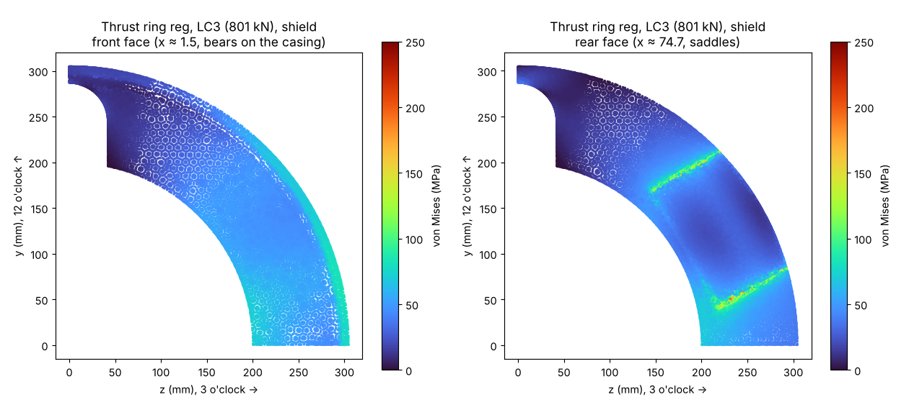
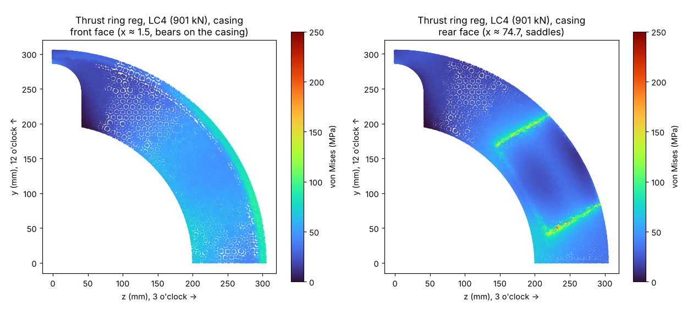

# Design manual Rev I · 06 Thrust ring Rev B

UATXcavators DN600 slurry microTBM (micro tunnel boring machine). Revision I, 2026-10-28. Generated by `tools/make_manual.py` from the model and calculation scripts in the repo; edit those, not this file.

Units mm, N, MPa (kN, kNm in tables). x = 0 at the ring 1 front face, +x rearward. Clock positions are seen from the front, looking rearward: 0° = 12 o'clock, 90° = 3 o'clock.

The thrust ring is launch equipment: it spreads the four cylinder forces onto the shield rear end (at launch) and then onto the rear end of the last jacking pipe. Rev B adds notches for the slurry pipes and a register spigot that locates the ring in the shield or casing bore. Design record: `docs/thrust-ring.md`. Calculations: `src/calc_revI.py` rows TR, `src/fea_thrust_ring.py`.

Parts and masses (model):

| Key | Part | kg |
|---|---|---|
| tring | Thrust ring 76.2 thk A572-50, Ø609.6 × Ø400, Ø589.5 × 10 register, notched 12 + 6 (Rev B) | 92.65 |
| tsaddles | Saddle blocks ×4, 144 × 100 × 45.5, Ø65 seat | 16.52 |
| tears | Saddle ears ×8, 20 × 80, R40, Ø39.5 slotted 3 | 3.80 |
| tsadwelds | Saddle welds, 8 mm fillet (none past the ring OD) | 0.32 |
| tpin60 | Saddle pin Ø38.1 × 160, 4140 HT, 2 o'clock | 1.43 |
| tpin120 | Saddle pin Ø38.1 × 160, 4140 HT, 4 o'clock | 1.43 |
| tpin240 | Saddle pin Ø38.1 × 160, 4140 HT, 8 o'clock | 1.43 |
| tpin300 | Saddle pin Ø38.1 × 160, 4140 HT, 10 o'clock | 1.43 |
| jcyl | Chief WT 5 × 24 ×4, retracted 889 (envelope) | 210.40 |

## 6.1 Cylinders

| Item | Value |
|---|---|
| Model | Chief WT 5 × 24 (Bailey SKU 216207), 4 off, at R260, 2, 4, 8 and 10 o'clock |
| Bore / rod / stroke | 127.0 / 63.5 / 609.6 |
| Pin to pin | 889 retracted, 1,498.6 extended |
| Cross tubes | Ø63.5 × 101.6 both ends, Ø38.5 pin bore |
| Rating | 3,000 psi (206.8 bar); test 4,500 psi |
| Mass | 52.6 kg each |
| Force per cylinder | p × 12,668 mm²: 153.3 kN (LC2), 200.1 kN (LC3), 225.3 kN (LC4); retract 50 bar on the annulus 9,501 mm² = 47.5 kN |

## 6.2 Ring and notches

| Item | Rev B |
|---|---|
| Ring | A572 Gr 50, Ø609.6 × Ø400; bearing face to rear face 76.2, 86.2 overall with the spigot, from 3.5 in plate (88.9) |
| Register | A register is a machined step that locates one part on another. Spigot (raised ring) on the bearing face: Ø589.5 × 10 high × 9 wide (R285.75-294.75), 1 × 45° lead-in at the tip; radial gap 0.55 in the Ø590.6 casing bore (24 in × 0.375 wall assumed). Relief groove 1.5 into the spigot × 0.5 below the bearing face at its root, so the pipe wall bears on flat face up to its bore edge (R295.3) |
| Shield rear end | Counterbored Ø590.6 × 12 to take the spigot like a casing end; end wall 9.5; spigot tip 2.0 short of the counterbore floor. Bearing annulus R295.3-304.8 = 17,910 mm² on both the shield and a casing end |
| Notches | U-notch at 12 and 6 o'clock, 84 wide, open to the bore, round end at R287, through the ring and the spigot (the spigot is cut back to R287 over the notch: 1.25 deep at the centreline). The Ø76.2 slurry pipes at R245 pass with 3.9 each side and 3.9 at the end; the spigot bore clears the pipe OD by 2.65 |
| Position at launch | Bearing face on the shield rear end wall, x = 1157.0 to 1233.2 (spigot to x = 1147.0); not bolted |
| Bore contents | Motor (R140, 60 clear), port bosses, hoses, seal-purge line (R185, 10 clear) |
| Mass | 92.7 kg (ring) |

Why a notch and not a hole: a hole would need the pipes threaded through it from the rear with the hoses off; the notch lets the ring slide on axially over the pipe ends and the hoses. The notches sit midway between cylinders, where the ring carries the least load (FEA below: notch zone ≈ half the ring stress).

## 6.3 Saddles, ears and pins (unchanged from Rev A)

| Item | Value |
|---|---|
| Saddle block | A572 Gr 50, 144 tangential × 100 radial × 45.5 high, welded to the ring rear face; Ø65 half-bore seat (1.5 diametral clearance on the Ø63.5 cross tube) |
| Thrust path | Rod → rod-end cross tube → seat → block → ring → shield or casing face. No pin, no weld in the thrust path |
| Ears | 2 × 20 × 80, R40 ends, 104 apart; Ø39.5 holes slotted 3 toward the ring, so the pin carries load only in retract |
| Pins | Ø38.1 × 160, 4140 HT, 2 clips each |
| Welds | 8 mm fillet on 316 of the 488 block perimeter (none where the block overhangs the ring OD by 5.2) |

## 6.4 FEA

Model: ring + register spigot + 4 fused saddle blocks, quarter model; seat loads as a Hertz-like pressure over ±20° about the seat bottom; compression-only springs on the bearing annulus R295.3-304.8 (chapter 01, section 1.9). The relief groove is not modelled, so the spigot root is a sharp re-entrant corner in the mesh; its peak is reported separately.

| Case | Support | F (kN) | Ring away from saddles, notches and spigot | Notch zone | Spigot zone peak | Block Pm + Pb | Ring under block Pm + Pb | Block zone peak | Contact | Max contact p (MPa) | u_x min (mm) |
|---|---|---|---|---|---|---|---|---|---|---|---|
| LC2 | shield | 613.1 | 68 | 31 | 71 | 37 | 33 | 214 | 100 % | 47.5 | -0.346 |
| LC2 | casing | 613.1 | 66 | 34 | 70 | 36 | 31 | 187 | 100 % | 50.1 | -0.203 |
| LC3 | shield | 800.6 | 89 | 40 | 92 | 48 | 43 | 279 | 100 % | 62.1 | -0.452 |
| LC3 | casing | 800.6 | 87 | 44 | 92 | 47 | 41 | 244 | 100 % | 65.4 | -0.266 |
| LC4 | shield | 901.4 | 100 | 45 | 104 | 54 | 49 | 314 | 100 % | 69.9 | -0.509 |
| LC4 | casing | 901.4 | 98 | 50 | 103 | 53 | 46 | 275 | 100 % | 73.6 | -0.299 |

Stresses von Mises, MPa.

Seat load model, Rev A ring at LC3 on the casing:

| Seat pressure | Ring away (MPa) | Block zone peak (MPa) | Ring max (MPa) |
|---|---|---|---|
| uniform pressure on the half groove | 98 | 293 | 183 |
| Hertz-like, ±20° about the seat bottom | 98 | 237 | 188 |

The uniform half-groove pressure ends abruptly at the groove edges and puts a false peak there (about 300 MPa at LC3); the cross tube in a slightly larger seat touches over a narrow arc around the seat bottom (Hertz half-width 5.6 mm at LC3 from row TR-6, about ±10°), so the Hertz-like model is the realistic one.

Cross-check with the Rev A curved-grid hand model (`docs/thrust-ring.md`): 112.7 MPa at 800 kN on the casing (k = 3,800 N/mm per mm); FEA ring away from the saddles on the casing at LC3 ≈ 87 MPa. The grid model is the more conservative of the two.

| ID | Part | Check | Case | Value | Allowable (basis) | FoS | FoS yield | Required | Status |
|---|---|---|---|---|---|---|---|---|---|
| TR-1 | Thrust ring | FEA: ring away from the saddles, notches and spigot root, on the shield | LC2 | 68.1 MPa | 345.0 (Fy) | 5.07 | 5.07 | 1.50 | ok |
| TR-2 | Thrust ring | FEA: notch zone (12 and 6 o'clock), on the shield | LC2 | 30.6 MPa | 345.0 (Fy) | 11.27 | 11.27 | 1.50 | ok |
| TR-3 | Saddle block | FEA: block under the seat, Pm+Pb (linearized), on the shield | LC2 | 36.8 MPa | 345.0 (Fy) | 9.38 | 9.38 | 1.50 | ok |
| TR-4 | Thrust ring | FEA: contact with the shield (fraction of the annulus in compression) | LC2 | 1.00 – | 1.0 (full contact) | 1.00 | – | 1.00 | ok |
| TR-12 | Thrust ring | FEA: register spigot and its root corner, on the shield | LC2 | 70.6 MPa | 345.0 (Fy) | 4.89 | 4.89 | reported | ok |
| TR-1 | Thrust ring | FEA: ring away from the saddles, notches and spigot root, on the casing | LC2 | 66.4 MPa | 345.0 (Fy) | 5.20 | 5.20 | 1.50 | ok |
| TR-2 | Thrust ring | FEA: notch zone (12 and 6 o'clock), on the casing | LC2 | 34.0 MPa | 345.0 (Fy) | 10.16 | 10.16 | 1.50 | ok |
| TR-3 | Saddle block | FEA: block under the seat, Pm+Pb (linearized), on the casing | LC2 | 36.2 MPa | 345.0 (Fy) | 9.52 | 9.52 | 1.50 | ok |
| TR-4 | Thrust ring | FEA: contact with the casing (fraction of the annulus in compression) | LC2 | 1.00 – | 1.0 (full contact) | 1.00 | – | 1.00 | ok |
| TR-12 | Thrust ring | FEA: register spigot and its root corner, on the casing | LC2 | 70.1 MPa | 345.0 (Fy) | 4.92 | 4.92 | reported | ok |
| TR-1 | Thrust ring | FEA: ring away from the saddles, notches and spigot root, on the shield | LC3 | 88.9 MPa | 345.0 (Fy) | 3.88 | 3.88 | 1.50 | ok |
| TR-2 | Thrust ring | FEA: notch zone (12 and 6 o'clock), on the shield | LC3 | 40.0 MPa | 345.0 (Fy) | 8.63 | 8.63 | 1.50 | ok |
| TR-3 | Saddle block | FEA: block under the seat, Pm+Pb (linearized), on the shield | LC3 | 48.0 MPa | 345.0 (Fy) | 7.19 | 7.19 | 1.50 | ok |
| TR-4 | Thrust ring | FEA: contact with the shield (fraction of the annulus in compression) | LC3 | 1.00 – | 1.0 (full contact) | 1.00 | – | 1.00 | ok |
| TR-12 | Thrust ring | FEA: register spigot and its root corner, on the shield | LC3 | 92.1 MPa | 345.0 (Fy) | 3.74 | 3.74 | reported | ok |
| TR-1 | Thrust ring | FEA: ring away from the saddles, notches and spigot root, on the casing | LC3 | 86.7 MPa | 345.0 (Fy) | 3.98 | 3.98 | 1.50 | ok |
| TR-2 | Thrust ring | FEA: notch zone (12 and 6 o'clock), on the casing | LC3 | 44.4 MPa | 345.0 (Fy) | 7.78 | 7.78 | 1.50 | ok |
| TR-3 | Saddle block | FEA: block under the seat, Pm+Pb (linearized), on the casing | LC3 | 47.3 MPa | 345.0 (Fy) | 7.29 | 7.29 | 1.50 | ok |
| TR-4 | Thrust ring | FEA: contact with the casing (fraction of the annulus in compression) | LC3 | 1.00 – | 1.0 (full contact) | 1.00 | – | 1.00 | ok |
| TR-12 | Thrust ring | FEA: register spigot and its root corner, on the casing | LC3 | 91.6 MPa | 345.0 (Fy) | 3.77 | 3.77 | reported | ok |
| TR-1 | Thrust ring | FEA: ring away from the saddles, notches and spigot root, on the shield | LC4 | 100.1 MPa | 345.0 (Fy) | 3.45 | 3.45 | 1.00 | ok |
| TR-2 | Thrust ring | FEA: notch zone (12 and 6 o'clock), on the shield | LC4 | 45.0 MPa | 345.0 (Fy) | 7.66 | 7.66 | 1.00 | ok |
| TR-3 | Saddle block | FEA: block under the seat, Pm+Pb (linearized), on the shield | LC4 | 54.0 MPa | 345.0 (Fy) | 6.38 | 6.38 | 1.00 | ok |
| TR-4 | Thrust ring | FEA: contact with the shield (fraction of the annulus in compression) | LC4 | 1.00 – | 1.0 (full contact) | 1.00 | – | 1.00 | ok |
| TR-12 | Thrust ring | FEA: register spigot and its root corner, on the shield | LC4 | 103.7 MPa | 345.0 (Fy) | 3.33 | 3.33 | reported | ok |
| TR-1 | Thrust ring | FEA: ring away from the saddles, notches and spigot root, on the casing | LC4 | 97.6 MPa | 345.0 (Fy) | 3.54 | 3.54 | 1.00 | ok |
| TR-2 | Thrust ring | FEA: notch zone (12 and 6 o'clock), on the casing | LC4 | 49.9 MPa | 345.0 (Fy) | 6.91 | 6.91 | 1.00 | ok |
| TR-3 | Saddle block | FEA: block under the seat, Pm+Pb (linearized), on the casing | LC4 | 53.3 MPa | 345.0 (Fy) | 6.48 | 6.48 | 1.00 | ok |
| TR-4 | Thrust ring | FEA: contact with the casing (fraction of the annulus in compression) | LC4 | 1.00 – | 1.0 (full contact) | 1.00 | – | 1.00 | ok |
| TR-12 | Thrust ring | FEA: register spigot and its root corner, on the casing | LC4 | 103.1 MPa | 345.0 (Fy) | 3.35 | 3.35 | reported | ok |
| TR-13 | Shield rear end | bearing face on the end wall Ø609.6 × Ø590.6 (counterbored for the register) | LC3 | 44.7 MPa | 216.9 (0.9 Fy (bearing, machined faces)) | 4.85 | 5.39 | 1.00 | ok |
| TR-14 | Shield rear end | axial compression in the 9.5 end wall over the 12 deep counterbore | LC3 | 44.7 MPa | 144.6 (0.6 Fy) | 3.23 | 5.39 | 1.00 | ok |
| TR-13 | Shield rear end | bearing face on the end wall Ø609.6 × Ø590.6 (counterbored for the register) | LC4 | 50.3 MPa | 216.9 (0.9 Fy (bearing, machined faces)) | 4.31 | 4.79 | 1.00 | ok |
| TR-14 | Shield rear end | axial compression in the 9.5 end wall over the 12 deep counterbore | LC4 | 50.3 MPa | 144.6 (0.6 Fy) | 2.87 | 4.79 | 1.00 | ok |
| TR-5 | Saddle block | seat bearing on the projected area 63.5 × 101.6 | LC3 | 31.0 MPa | 310.5 (0.9 Fy) | 10.01 | 11.12 | 1.00 | ok |
| TR-6 | Saddle block | Hertz line contact, cross tube Ø63.5 in the Ø65 seat | LC3 | 223.8 MPa | 501.0 (first sub-surface yield 1.67 Fy (Fy 300 cross tube)) | 2.24 | – | 1.50 | ok |
| TR-7 | Saddle block | block compression under the seat, 144 × 100 | LC3 | 13.9 MPa | 207.0 (0.6 Fy) | 14.89 | 24.82 | 1.00 | ok |
| TR-5 | Saddle block | seat bearing on the projected area 63.5 × 101.6 | LC4 | 34.9 MPa | 310.5 (0.9 Fy) | 8.89 | 9.88 | 1.00 | ok |
| TR-6 | Saddle block | Hertz line contact, cross tube Ø63.5 in the Ø65 seat | LC4 | 237.5 MPa | 501.0 (first sub-surface yield 1.67 Fy (Fy 300 cross tube)) | 2.11 | – | 1.50 | ok |
| TR-7 | Saddle block | block compression under the seat, 144 × 100 | LC4 | 15.6 MPa | 207.0 (0.6 Fy) | 13.23 | 22.05 | 1.00 | ok |
| TR-8 | Saddle pins | pin bending in retract, span 104 + 2 × 20 (simply supported, central load) | retract | 135.6 MPa | 393.0 (0.6 Fy) | 2.90 | 4.83 | 1.00 | ok |
| TR-9 | Saddle pins | pin double shear in retract | retract | 20.8 MPa | 262.0 (0.4 Fy) | 12.58 | 18.14 | 1.00 | ok |
| TR-10 | Saddle welds | 8 mm fillet on 316 of the 488 perimeter, retract | retract | 26.6 MPa | 144.6 (0.3 × 482) | 5.45 | 8.69 | 1.00 | ok |
| TR-11 | Cylinders | rod column, both ends pinned, full pin-to-pin length (Euler) | LC3 | 200.1 kN | 701.0 (P_cr) | 3.50 | – | 1.00 | ok |
| TR-11 | Cylinders | rod column, both ends pinned, full pin-to-pin length (Euler) | LC4 | 225.3 kN | 701.0 (P_cr) | 3.11 | – | 1.00 | ok |

Equations behind the rows:

- **TR-1 LC2**: max von Mises → **68.06 MPa**
- **TR-2 LC2**: max von Mises → **30.62 MPa**
- **TR-3 LC2**: seat floor → ring rear face → **36.76 MPa**
- **TR-4 LC2**: compression-only foundation iteration → **1.00 –**
- **TR-12 LC2**: max von Mises (sharp re-entrant corner in the mesh; the part has a 1.5 × 0.5 relief groove there) → **70.55 MPa**. peak at a modelled sharp corner, reported only
- **TR-1 LC2**: max von Mises → **66.36 MPa**
- **TR-2 LC2**: max von Mises → **33.97 MPa**
- **TR-3 LC2**: seat floor → ring rear face → **36.24 MPa**
- **TR-4 LC2**: compression-only foundation iteration → **1.00 –**
- **TR-12 LC2**: max von Mises (sharp re-entrant corner in the mesh; the part has a 1.5 × 0.5 relief groove there) → **70.12 MPa**. peak at a modelled sharp corner, reported only
- **TR-1 LC3**: max von Mises → **88.87 MPa**
- **TR-2 LC3**: max von Mises → **39.98 MPa**
- **TR-3 LC3**: seat floor → ring rear face → **48.00 MPa**
- **TR-4 LC3**: compression-only foundation iteration → **1.00 –**
- **TR-12 LC3**: max von Mises (sharp re-entrant corner in the mesh; the part has a 1.5 × 0.5 relief groove there) → **92.13 MPa**. peak at a modelled sharp corner, reported only
- **TR-1 LC3**: max von Mises → **86.66 MPa**
- **TR-2 LC3**: max von Mises → **44.35 MPa**
- **TR-3 LC3**: seat floor → ring rear face → **47.32 MPa**
- **TR-4 LC3**: compression-only foundation iteration → **1.00 –**
- **TR-12 LC3**: max von Mises (sharp re-entrant corner in the mesh; the part has a 1.5 × 0.5 relief groove there) → **91.56 MPa**. peak at a modelled sharp corner, reported only
- **TR-1 LC4**: max von Mises → **100.06 MPa**
- **TR-2 LC4**: max von Mises → **45.01 MPa**
- **TR-3 LC4**: seat floor → ring rear face → **54.05 MPa**
- **TR-4 LC4**: compression-only foundation iteration → **1.00 –**
- **TR-12 LC4**: max von Mises (sharp re-entrant corner in the mesh; the part has a 1.5 × 0.5 relief groove there) → **103.72 MPa**. peak at a modelled sharp corner, reported only
- **TR-1 LC4**: max von Mises → **97.56 MPa**
- **TR-2 LC4**: max von Mises → **49.93 MPa**
- **TR-3 LC4**: seat floor → ring rear face → **53.27 MPa**
- **TR-4 LC4**: compression-only foundation iteration → **1.00 –**
- **TR-12 LC4**: max von Mises (sharp re-entrant corner in the mesh; the part has a 1.5 × 0.5 relief groove there) → **103.08 MPa**. peak at a modelled sharp corner, reported only
- **TR-13 LC3**: σ = F/A = 800.6 kN / 17,910 mm² → **44.70 MPa**
- **TR-14 LC3**: σ = F/A = 800.6 kN / 17,910 mm² → **44.70 MPa**
- **TR-13 LC4**: σ = F/A = 901.4 kN / 17,910 mm² → **50.33 MPa**
- **TR-14 LC4**: σ = F/A = 901.4 kN / 17,910 mm² → **50.33 MPa**
- **TR-5 LC3**: σ = F_cyl/(d L) = 200.1 kN/(63.5 × 101.6) → **31.02 MPa**
- **TR-6 LC3**: b = √(4qR/πE*) = 5.6 mm, p_max = 2q/(πb), q = 1970 N/mm, R = 1/(1/31.75 − 1/32.5) = 1376 → **223.80 MPa**. line contact: τ_max = 0.30 p_max at depth 0.79 b; Tresca first yield at τ_max = Fy/2 → p_max = 1.67 Fy; cross-tube steel taken as Fy 300
- **TR-7 LC3**: σ = F_cyl/(144 × 100) → **13.90 MPa**
- **TR-5 LC4**: σ = F_cyl/(d L) = 225.3 kN/(63.5 × 101.6) → **34.93 MPa**
- **TR-6 LC4**: b = √(4qR/πE*) = 5.9 mm, p_max = 2q/(πb), q = 2218 N/mm, R = 1/(1/31.75 − 1/32.5) = 1376 → **237.46 MPa**. line contact: τ_max = 0.30 p_max at depth 0.79 b; Tresca first yield at τ_max = Fy/2 → p_max = 1.67 Fy; cross-tube steel taken as Fy 300
- **TR-7 LC4**: σ = F_cyl/(144 × 100) → **15.65 MPa**
- **TR-8 retract**: M = P L/8 with L = 124; σ = 32M/(πd³) → **135.60 MPa**
- **TR-9 retract**: τ = P/(2 × π/4 × 38.1²) → **20.83 MPa**
- **TR-10 retract**: σ = P/(L × 0.707 × 8) = 47.5e3/(316.3 × 5.66) → **26.55 MPa**
- **TR-11 LC3**: P_cr = π²EI/L² = 701 kN; P = 200 kN → **200.15 kN**
- **TR-11 LC4**: P_cr = π²EI/L² = 701 kN; P = 225 kN → **225.34 kN**
